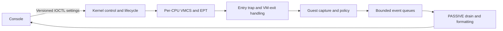

# Velum | Windows x64 Research Hypervisor

**Intel VT-x virtualization, EPT hooking and interactive kernel telemetry in C and x64 assembly.**

Velum brings a running Windows kernel into VMX non-root operation and gives researchers
an interactive way to observe native calls, inspect kernel activity and apply request
policies. Its EPT hooks replay original instructions in hardware, while guest helpers
capture metadata and a deferred worker delivers readable events to the console or DebugView.

Use it to follow a file operation from input arguments to a policy decision, compare
an allowed request with a denied one, or explore processor identity and timing settings
without restarting the hypervisor. The implementation includes per-CPU startup and shutdown,
CET state transfer, event reinjection and translation-cache management.

[Get started](readmes/getting-started/README.md) |
[Usage guides](readmes/README.md) |
[Technical write-up](readmes/technical-writeup/README.md) |
[Runtime captures](assets/README.md) | [MIT License](LICENSE)

## Capabilities

| Area | What you can do |
| --- | --- |
| EPT hooks | Enable and disable exported-entry hooks with original-instruction replay and MTF restoration |
| Native-call telemetry | Inspect caller IDs, paths, process metadata and decoded input arguments |
| Request policies | Deny matching Nt requests using caller, path and input-field criteria |
| Access reduction | Remove explicit requested rights for NtCreateFile, NtOpenFile, NtCreateSection, NtOpenProcess and NtDuplicateObject |
| Kernel observation | Follow pool allocation/free, memory mapping and copy inputs; inspect module/tag summaries |
| Logging | Choose live-console or DebugView output and configure per-target filters |
| CPUID | Apply and query identity rules, then restore the defaults |
| TSC | Apply a fixed signed offset with deadline translation and reset to zero |
| Lifecycle | Check each participating CPU and return Windows to native execution through the shutdown flow |

The target catalog contains **12 Nt routines and 12 Ex/Mm routines**. The console resolves
available exports and shared entry addresses on the running kernel. See the
[target index](readmes/README.md) for each target's fields and supported actions.

## Architecture



Root handlers manage VMCS and EPT transitions. Eligible guest helpers capture arguments
and evaluate policies in Windows context. Formatting runs later in the drain worker.
An allowed call executes its original entry instruction under a temporary EPT mapping;
MTF returns control to restore the shadow. Denied calls use a real guest return so the
normal stack and CET shadow stack advance together.

## Technical documentation

For an in-depth explanation, read
[Velum: preserving Windows execution across VMX transitions](readmes/technical-writeup/README.md).
The article follows VMX startup, VMCS controls, EPT hooks, CET, NMI/event handling,
telemetry and shutdown through the source code. It includes WinDbg evidence from the
Windows 10 investigation and explains the ExFreePool/ExFreePoolWithTag alias fix.
The shorter [engineering notes](readmes/engineering/README.md) summarize those decisions.

## Recorded demonstrations

The captures below come from a physical Windows 11 build 26300.9711 session on an
Intel i7-12700F with 20 logical processors. The session includes **20/20 CPU diagnostic
checks**, scoped file-write denial, access reduction, processor configuration and verified
shutdown. [Full gallery and animations](assets/README.md) | [Session details and hashes](assets/capture-manifest.md).

### Interactive control

Enable hooks, configure policies, inspect CPU state and manage the runtime from one console.


### File-write telemetry

A controlled six-byte NtWriteFile request with its caller, path and input fields.


### Access reduction with an independent result

Requested access `0x12019F` becomes `0x120199` after removing mask `0x6`. The open
succeeds, and the probe confirms that the resulting handle cannot write. This labeled
composite pairs the monitor output with the application's result.


## Additional PoC screenshots

### Hook setup and entry diagnostics


### Live kernel telemetry


## Build and run

Install Visual Studio **2022 or 2026** with C++ x64 tools, plus a matching Windows SDK
and WDK. [`build.bat`](build.bat) discovers the installed tools; `VS_PATH`, `WDK_ROOT`
and `WDK_VER` allow explicit selection. See the [build requirements](readmes/getting-started/README.md#3-build)
for kit compatibility and the locally verified configuration.

```bat
build.bat check
build.bat
```

The default optimized Release build produces `x64/Release/velum.sys` and
`x64/Release/velum-console.exe`, with no PE debug directory or PDB output.
`build.bat diagnostic` is an explicit opt-in for separate diagnostic binaries and symbols.
Runtime telemetry remains available in Release. Generated output stays outside Git.

The [setup guide](readmes/getting-started/README.md) covers temporary F7 loading, installation,
Intel VT-x/EPT requirements, guest Hyper-V/VBS settings and the tested VMware configuration.
After loading the prepared driver, run the matching console as administrator:

```bat
velum-console.exe
velum-console.exe status
velum-console.exe remove
```

Start with one hook and a controlled workload. Use `remove` for the shutdown and service
removal flow; closing the console leaves the runtime installed.

## Validation and research scope

Release builds use `/W4 /WX` and validate output PE properties. Maintainer-local suites
reported **8,272 host checks** and **1,936 mocked event-preparation checks** passing.
These suites are not included in the public source distribution. The operator confirmed
the rebuilt Release pair working on **Windows 10 22H2** and **Windows 11 26H2**.
Earlier all-hook and lifecycle checks in VMware and the physical-machine captures
have their own recorded environments.

Velum is a research project for authorized, recoverable lab systems. Target availability
and detailed capture depend on kernel exports and execution context. Entry logs describe
inputs and decisions; application results establish completion. Policies require successful
capture and generally continue on capture failure. Telemetry queues can drop events.
Performance, power transitions and dynamic topology are not yet characterized. The
[technical article](readmes/technical-writeup/README.md#17-limitations-and-next-experiments)
records these boundaries and the next experiments.

## Repository layout

```text
hypervisor/    Kernel C, assembly and per-CPU runtime
user-mode/     Interactive control console
shared/        Protocols, field schemas and policy helpers
readmes/       Setup, usage guides and technical articles
assets/        Runtime screenshots, animations and capture metadata
build.bat      Source-build entry point
LICENSE        MIT License
```

For reports, see [SECURITY.md](SECURITY.md). References:
[Intel SDM](https://www.intel.com/content/www/us/en/developer/articles/technical/intel-sdm.html),
[Windows driver documentation](https://learn.microsoft.com/en-us/windows-hardware/drivers/),
and [PHNT native definitions](https://github.com/winsiderss/phnt).
