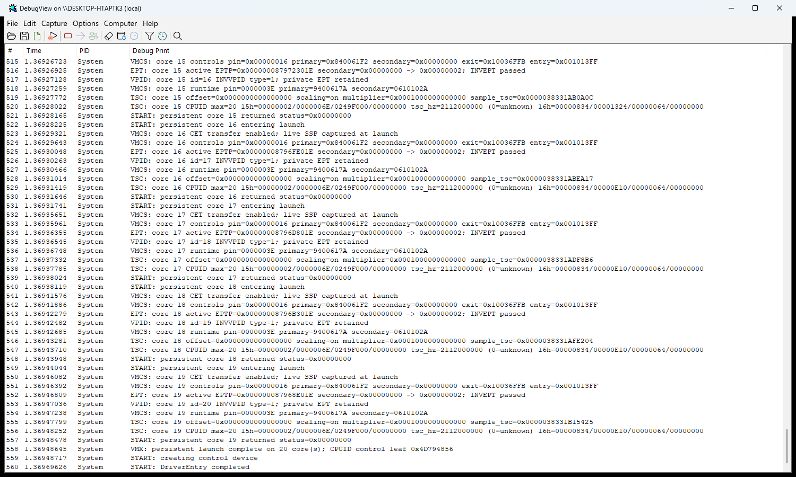
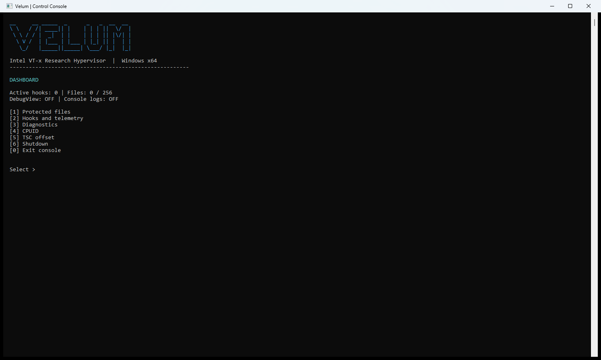
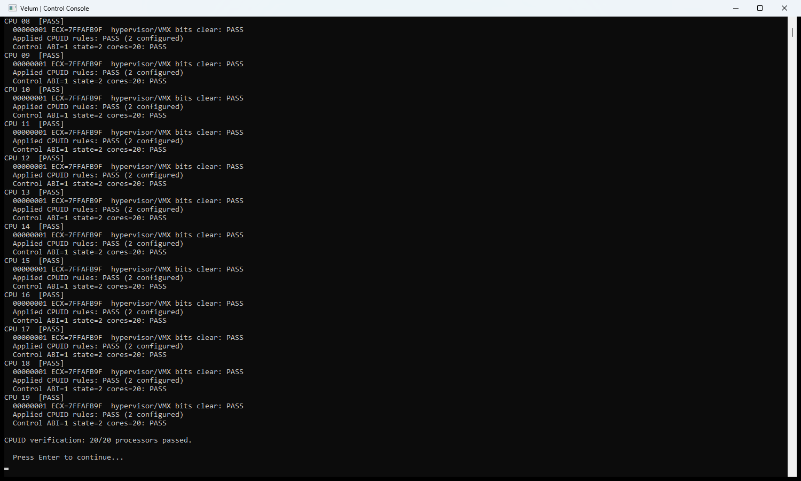
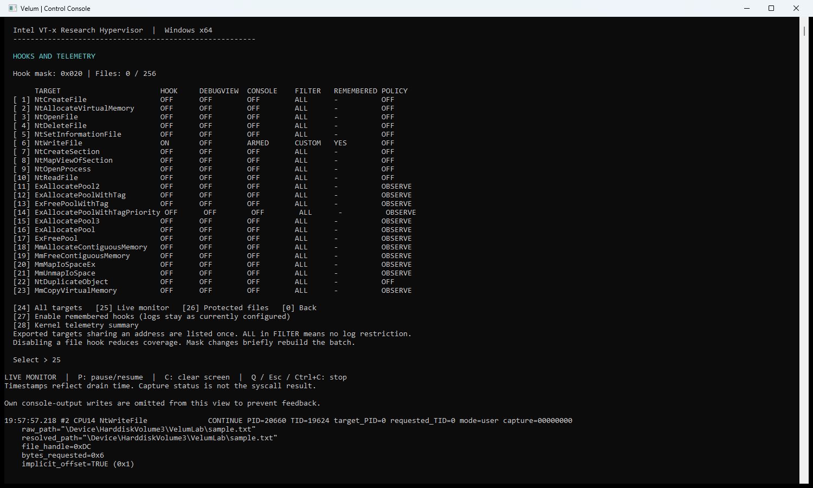
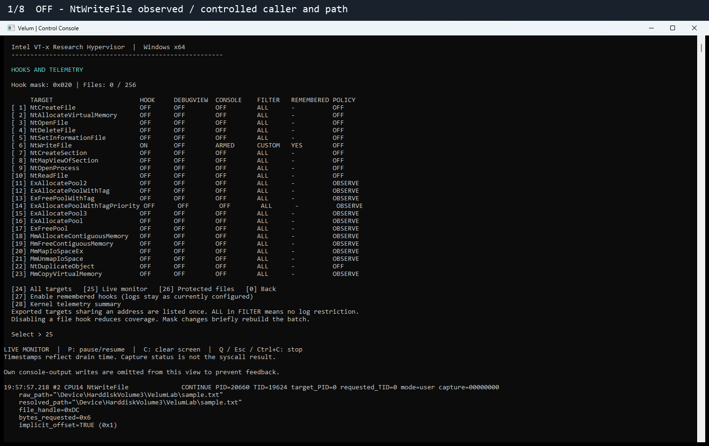
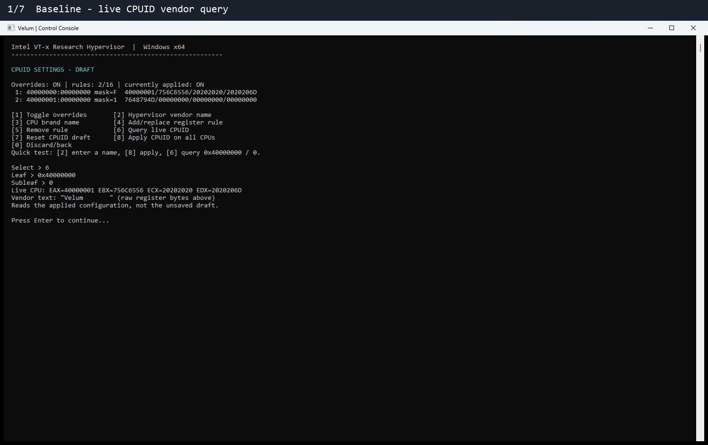
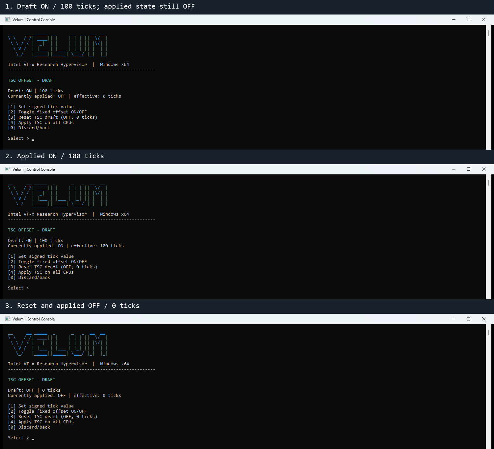
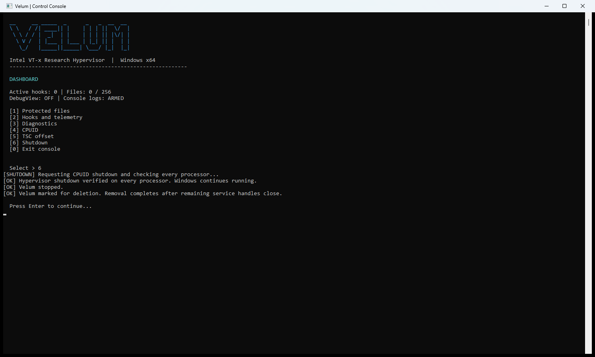
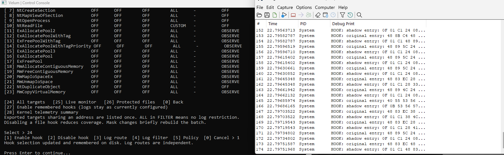
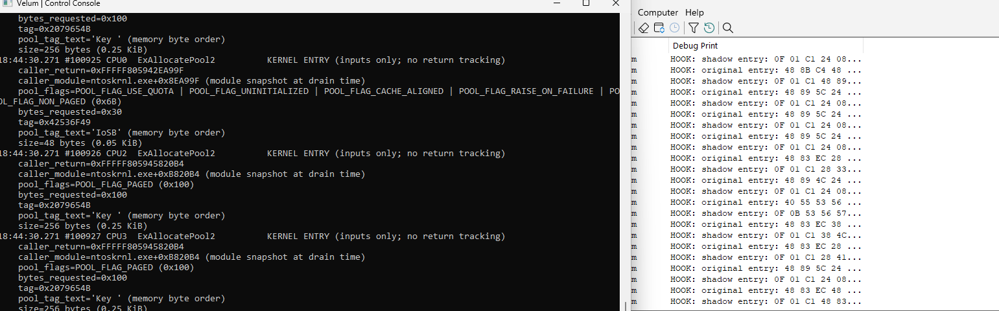

# Runtime capture gallery

[Project overview](../README.md) | [Usage guides](../readmes/README.md) | [Capture manifest](capture-manifest.md)

The supplied captures document the 2026-10-24 physical Windows 11 session
(build 26300.9711, Intel i7-12700F, 20 logical processors). They do not depict
the earlier VMware tests. Full provenance, binary hashes and reproduction notes
are in the manifest. The GIFs are timed sequences of captured screens; the access
and TSC comparisons are labeled composites. They are not uninterrupted video.

Images are embedded below; open them at full size for small console text.

### Startup in DebugView

The visible startup tail records persistent launch on 20 CPUs and DriverEntry completion.

### Control dashboard

The console immediately after loading, with hooks OFF.

### Per-CPU diagnostics

The final viewport reports 20/20 processors passed. This validates the displayed checks, not every hypervisor behavior.

### NtWriteFile entry telemetry

A six-byte request from the scoped caller is observed. CONTINUE describes the policy decision, not the completed write result.

### Scoped deny: OFF / DENY / OFF

The same caller and file handle succeed, fail with Win32 error 5 while contents remain unchanged, then succeed after disabling the policy. A chronological screenshot sequence with reading pauses, not continuous video.

### Access reduction and independent result

Requested access 0x12019F becomes 0x120199 after removing mask 0x6. The open succeeds, but a subsequent write is denied. This labeled composite pairs real monitor and probe captures.

### Applied access policy

Caller/path scope and remove mask 0x6 for NtCreateFile.

### Independent access probe

The original probe window compares a successful baseline write with a reduced-rights handle that cannot write.

### Kernel telemetry summary

Ambient ExAllocatePool2 input observations. This run visibly reports 1,303,982 queue drops and 2,384 summary overflow events: it is lossy telemetry, not a complete allocation accounting or performance benchmark.

### CPUID apply and reset

A live vendor query changes to VelumLabDemo and returns to the Velum default after Reset/Apply. Reset does not turn overrides OFF. This is a chronological screenshot sequence, not continuous video.

### TSC offset configuration

A labeled three-state composite: draft ON/100 ticks, applied ON/100, then reset OFF/0. It demonstrates configuration, not reduced latency.

### Verified shutdown

The console reports native return verified on all processors and service removal requested. The session manifest records the subsequent service-absence check.

## Adding future captures

Keep stills in `assets/screenshots/` and animations in `assets/demos/`.
Document OS build, CPU/vCPU count, binary hashes, target, scope, workload and result
in the manifest. Pair policy logs with an independent application result.
For smoother future demos, record a continuous short sequence with a larger console
font and a tighter window, keeping the OFF/ON/OFF result readable. Preserve original
captures and do not remove error/drop counters from evidence.

## Additional operator-supplied PoC screenshots

