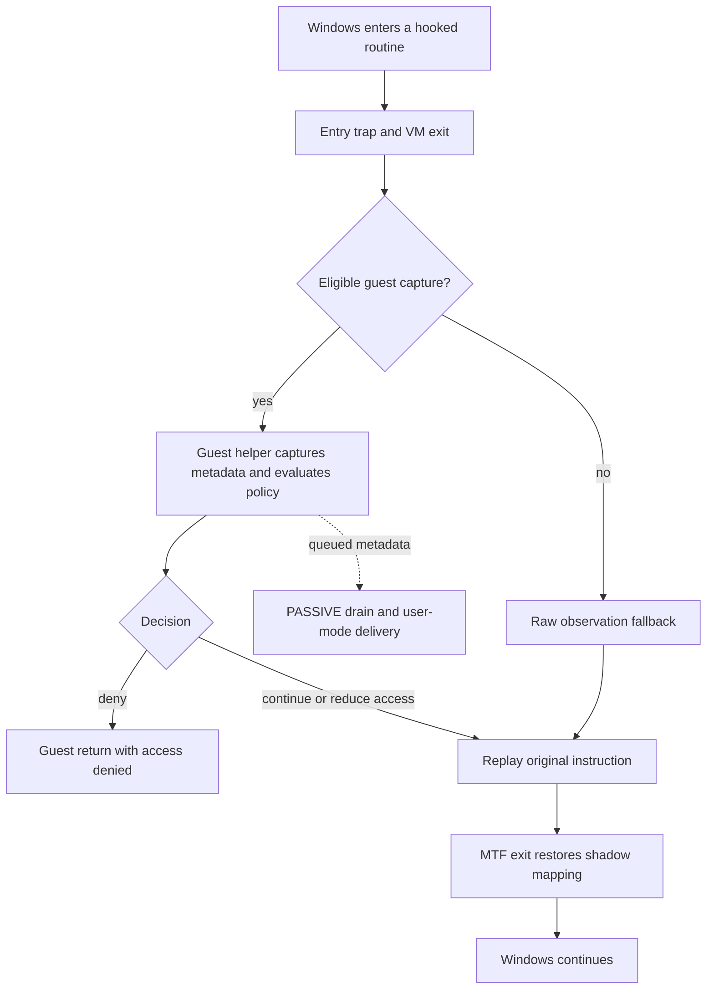

# Engineering notes: state transitions and compatibility

[Documentation index](../README.md) | [Project](../../README.md)

For the full implementation study, read [the technical write-up](../technical-writeup/README.md).

## Runtime organization

Velum brings an already-running Windows kernel into VMX non-root operation on
each participating CPU. Per-CPU VMCS and EPT state are prepared before persistent
launch. A supported exported entry is observed through an EPT shadow mapping;
the runtime uses UD2 for supported two-byte entries or VMCALL for longer entries,
and replays the original instruction
under the original mapping. MTF returns control after replay so the shadow can
be restored. Changes invalidate the relevant EPT translations.



Root and guest responsibilities are intentionally separate. Root handlers avoid
blocking allocation/log formatting and do not use arbitrary guest pointers for
metadata capture. Eligible guest helpers perform guarded reads; passive consumers
format and resolve module information. The failure path is not ordinary execution:
unrecoverable persistent errors enter the fatal path rather than resume bad state.

## CET: why the code exists

Control-flow Enforcement Technology can carry supervisor control, shadow-stack
pointer and interrupt shadow-stack-table state across VM transitions. Preserving
only RIP/RSP is insufficient when this state is active. The launcher captures
the CET triplet immediately before entry, with no intervening CALL that would
change the intended shadow-stack position. Entry/exit controls are validated.
Persistent root code uses a separate CET-disabled root policy while preserving
guest state; native shutdown transfers the guest state back for return to Windows.
Filter denial uses a real guest RET instead of a synthetic return-address trick.

The startup trace confirms CET state transfer is enabled. Active PKS, unsupported
LDTR/TSS state and unavailable required controls are rejected during setup.

Source: [VMCS setup](../../hypervisor/src/vmcs.c), [assembly transitions](../../hypervisor/src/vmx.asm),
[native return](../../hypervisor/src/native.c). Architectural reference:
[Intel SDM](https://www.intel.com/content/www/us/en/developer/articles/technical/intel-sdm.html).

## CR0.TS and FXSAVE

Review found a conditional startup defect: the host entry stub executes FXSAVE64,
but the startup probe's host CR0 previously inherited TS. If TS was set, #NM could
occur before dispatch. Common host-state setup now clears TS, and the launcher
saves/restores the native CR0. Guest CR0 is not cleared as a workaround.

The Windows 10 startup freeze persisted with CR0=0x80050033 and TS clear.
It was resolved separately by the VMware configuration change below.

## Windows 10 nested startup: evidence and resolution

The Windows 10 build 19045 trace passed probes on four active CPUs and returned
from persistent core 0; the last recorded stage was core 1 runtime preparation:

```text
START: persistent core 0 returned status=0x00000000
START: persistent core 1 entering launch
VMCS: core 1 runtime pin=0000003E primary=9400617A secondary=0010102A
```

The working Windows 11 `.vmx` contained `hypervisor.cpuid.v0 = "FALSE"`; Windows
10 lacked it. With Windows 10 fully powered off, its `.vmx` was backed up and
that setting was added. Startup then succeeded in the tested configuration. The boot-time VMware setting is distinct from Velum's later CPUID
overrides. Both guests needed nested VT-x/EPT exposure. Follow the
[setup guide](../getting-started/README.md) rather than copying arbitrary host settings.

## Duplicate exported entries: ExFreePool / ExFreePoolWithTag

Enable-all originally failed with Win32 error 50 / STATUS_NOT_SUPPORTED:

```text
HOOK: syscall idx=19 core=0 prepare failed status=0xC00000BB
```

The WinDbg session showed:

```text
0: kd> x nt!ExFreePool*
fffff800`32350490 nt!ExFreePoolEx
fffff800`329b70b0 nt!ExFreePool
fffff800`329b70b0 nt!ExFreePoolWithTag
fffff800`329eff40 nt!ExFreePoolSanityChecks

0: kd> u nt!ExFreePool
fffff800`329b70b0 4883ec28        sub rsp,28h
fffff800`329b70b4 e8974f88ff      call nt!ExFreeHeapPool
fffff800`329b70b9 4883c428        add rsp,28h
fffff800`329b70bd c3              ret

0: kd> db nt!ExFreePool L10
fffff800`329b70b0 48 83 ec 28 e8 97 4f 88-ff 48 83 c4 28 c3 cc cc
```

Addresses are from that session, not constants. The original entry instruction
was supported. The first alias modified the shared shadow entry; the second
attempt encountered the already-modified entry and failed preparation.

Availability now chooses one representative per resolved address, preferring
ExFreePoolWithTag for this alias. The installer also rejects duplicate addresses
before modification. If the addresses differ, both names remain selectable.
Selection follows the actual resolved addresses on each running kernel.

An alias hook cannot recover which symbolic name a caller used. Untagged
ExFreePool callers can leave an uninterpretable tag register. Interpret tag fields according to the caller's arguments. All-hook runs passed
in both Windows 10 and Windows 11 guests.

Source: [entry representative selection](../../shared/target_entries.h),
[availability](../../hypervisor/src/syscall.c), [hook preparation](../../hypervisor/src/hook.c).

## NMI/IRET and interrupted events

Runtime virtual-NMI handling restores NMI blocking when an EPT exit reports
IRET unblocking and no valid IDT-vectoring event is present. Unrelated
interruptibility bits are preserved. Event error codes and software-event
instruction lengths are transferred with checked VMREAD/VMWRITE results;
failure prevents normal guest continuation. The host suite tests the actual
helper with mocked VMCS operations, including failures at each operation.
These checks exercise the helper's state transitions; hardware delivery is covered
separately by runtime testing.

## Runtime optimization and state handling

- CR3/CR8, ordinary I/O and timestamp instructions are not indiscriminately trapped.
- MTF is scoped to replay/return windows; it is not continuous single-stepping.
- VPID is capability-dependent; safe fallback exists when required invalidation
  support is unavailable. EPT mapping changes still need INVEPT.
- TSC starts with zero offset and identity scaling where supported.
- EPT memory types use an initial MTRR snapshot; runtime MTRR changes are not
  synchronized. EPT accessed/dirty tracking is not enabled by this design.
- Guest x87/SSE, CR2 and DR6 are preserved in the exit stub. Full arbitrary
  root AVX-state use is not implied by guest XSAVE support.
- The runtime uses a fixed processor topology; power and topology transitions
  are separate lifecycle work.

## Test results

| Test | Result |
| --- | --- |
| Release build | Optimized output with `/W4 /WX` and PE checks passed |
| Host regression suite | 8,272 input, policy, formatter, profile and processor checks passed |
| Event regression suite | 1,936 mocked VMCS reinjection, NMI restoration and failure checks passed |
| Windows 10 22H2 | All-hook operation and lifecycle tests passed |
| Windows 11 26H2 | All-hook operation and lifecycle tests passed |
| Physical Windows 11 session | 20/20 per-CPU diagnostics, policy demonstrations and native return verified |

Regression suites are maintained locally. The [runtime gallery](../../assets/README.md)
and [capture manifest](../../assets/capture-manifest.md) show the recorded workloads
and results; the [release record](../../assets/release-validation.md) lists binary hashes.
