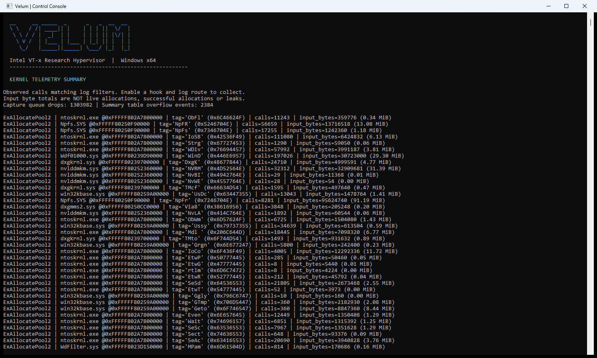

# Kernel routine telemetry and summary

[Documentation index](../../README.md) | [Project](../../../README.md)

Supported Ex targets: ExAllocatePool2, ExAllocatePool3, ExAllocatePoolWithTag,
ExAllocatePoolWithTagPriority, ExAllocatePool, ExFreePoolWithTag and ExFreePool.
Additional targets: MmAllocateContiguousMemory, MmFreeContiguousMemory,
MmMapIoSpaceEx, MmUnmapIoSpace and MmCopyVirtualMemory. Each has independent hook, log route and
numeric-field settings. MmGetSystemRoutineAddress resolves exports; missing
exports are hidden. Entry instruction support still determines hook installation.

Events decode each routine's input registers: flags/type, bytes, tag, priority,
free pointer, physical address, highest acceptable address or protection as
applicable. Tags include printable memory-byte-order text and hex; sizes include
bytes and KiB. ExAllocatePool3 records the extended-parameters pointer only;
its fifth argument and pointed-to contents are not captured.

MmCopyVirtualMemory records source/target process-object pointers, source/target
addresses, requested bytes, the previous-mode argument and the output-size
pointer. These are input values, not process IDs, copied data or completion
results. A guarded guest-context read captures its three stack arguments when
eligible; otherwise only the four register arguments are available. Missing
fields remain unavailable and do not match numeric field conditions. The output
size pointer is never dereferenced. This routine has no documented WDK contract;
its observational argument schema is experimental and requires validation on
each Windows build.

In eligible guest contexts a small resident helper captures the entry stack's
return slot. VMX root never dereferences it. The passive drain worker resolves
that address against a bounded loaded-module snapshot refreshed at most once a
second using [AuxKlibQueryModuleInformation](https://learn.microsoft.com/en-us/windows-hardware/drivers/ddi/aux_klib/nf-aux_klib-auxklibquerymoduleinformation).
The output shows the return address and module+offset when available. This is
best-effort immediate return-site attribution, not a stack trace or allocation
owner: wrappers, tail calls, module unloading/address reuse and snapshot delay
limit its interpretation. Failed resolution remains explicitly unresolved.
Ineligible contexts retain register-only events. No caller PID/TID is collected.

Select **Kernel telemetry summary** in Hooks and Telemetry to view or reset
per-routine/module/tag call counts and input-byte totals. Unknown modules are
grouped by captured return address. Counts cover drained events that match the
log filter while capture routes are enabled. Filters do not change old totals;
reset them when starting a new measurement. Reset clears accumulated counters;
already queued events can appear after reset. Free events have no byte total;
MmUnmapIoSpace totals describe requested unmap lengths. Nested allocation
wrappers may produce multiple events for one logical operation.
For MmCopyVirtualMemory, uncaptured sizes are excluded from byte totals and
reported separately as size_unknown_calls.

The guest queue holds 512 entries; producers drop on contention/full capacity.
The module snapshot holds 512 modules; an oversized/failed query leaves resolution
unavailable. The summary holds 256 distinct keys and counts excess events as
table overflow. Queue-drop and table-overflow counters are shown separately;
raw-fallback and console-delivery drops belong to their existing queues.
Counters saturate at UINT64_MAX. The drain worker suppresses its own guest
capture to limit feedback; other console/system allocations can still generate
traffic. Filtering happens after capture, so heavy traffic can lose events.

These routines remain observation-only, with no return hooks, argument changes,
allocation/free correlation or leak detection. Input totals never prove successful
allocation, live memory usage or freed bytes. Hooks/log routes remain opt-in.

## Walkthrough

1. Select one available Ex/Mm target and enable its hook.
2. Choose a route; for Console enter live monitor so capture is active.
3. Run the controlled workload described by that routine's guide.
4. Exit the viewer and choose **Kernel telemetry summary** in the hook menu.
   Inspect routine/module/tag groups and queue/table overflow counters.
5. Use the displayed reset option before a new experiment. Reset is not a
   synchronization barrier; queued events may arrive afterwards.
6. Disable the route and hook at the end.

These totals are observed input traffic, not allocation ownership, leaks, live
bytes, successful copies, or return values. A return-site module is not a full
call stack. Use a dedicated test driver for exact Ex/Mm calls; a user-mode
workload can exercise wrappers but does not guarantee a specific exported entry.

Implementation: [telemetry](../../../hypervisor/src/kernel_telemetry.c),
[capture schema](../../../shared/kernel_telemetry.h).

## Recorded example

These captures are from the physical Windows 11 session, not a VMware guest.
See the [session manifest](../../../assets/capture-manifest.md) for environment and reproduction details.

### Kernel telemetry summary

Ambient ExAllocatePool2 input observations. This run visibly reports 1,303,982 queue drops and 2,384 summary overflow events: it is lossy telemetry, not a complete allocation accounting or performance benchmark.

