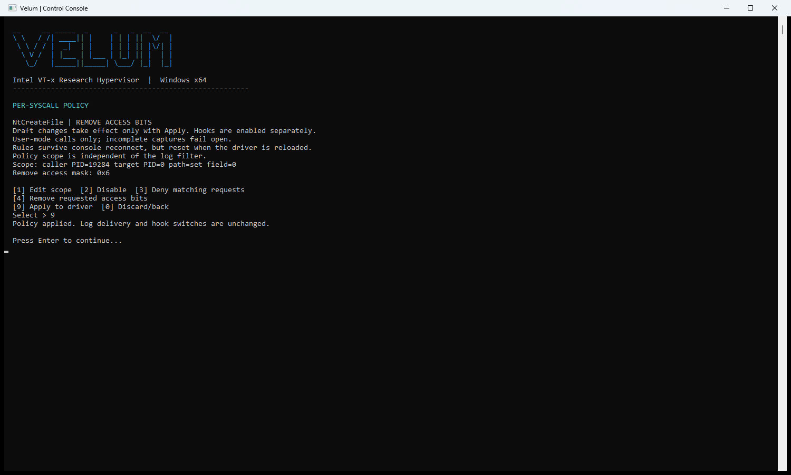
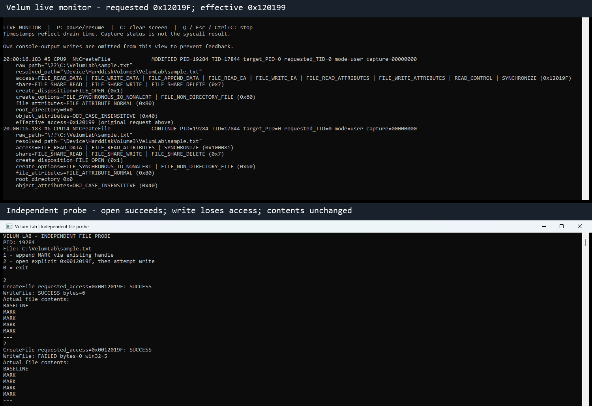
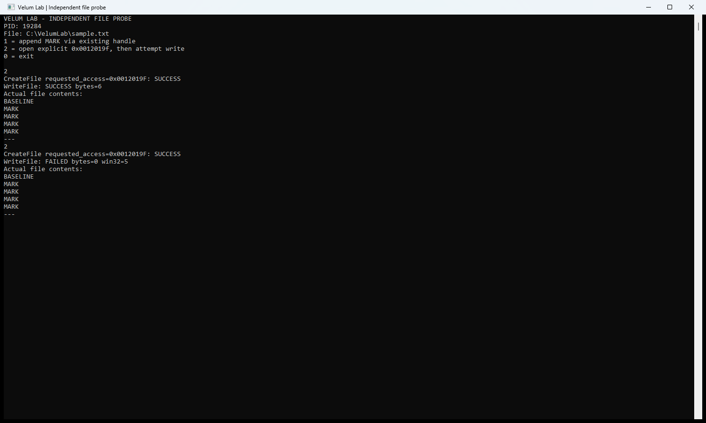

# NtCreateFile

[Documentation index](../../README.md) | [Project](../../../README.md)

Create/open a file with a native create disposition.

## Capability contract

| Capability | Support |
| --- | --- |
| Stable protocol target ID | 0 (not the Windows syscall number or console row) |
| Hook / input observation | If the export resolves and the entry is supported |
| Numeric log condition | One of the fields below |
| Path sources | file path |
| Caller PID/TID, mode/action log criteria | Yes, when metadata is captured |
| Target PID criterion | No |
| Blocking policy | Yes: scoped deny |
| Argument modification | Yes: explicit requested access bits only |

## Enable and observe

1. Complete the [VM setup](../../getting-started/README.md) and load the matching pair.
2. Dashboard **[2] Hooks and telemetry -> NtCreateFile -> [1] Enable hook**.
   Select by name: row numbers change with export availability and aliases.
3. Select the target again -> **[3] Log route -> [2] Console**.
4. Select **Live monitor**, then run the controlled workload below elsewhere in the guest.
5. Verify the target name and captured fields before adding a filter or policy.
   Press Q to leave live view; the hook remains installed.

If the row is missing, the export may not resolve or may share another target's
address. If enabling fails, capture the named prepare failure rather than
assuming the menu or a file path is invalid. No SSDT/signature fallback is used.

## Captured numeric fields

These are input metadata. Field numbers match the filter menu, including gaps.
Pointers and handles are numeric values; requested sizes are bytes. Not every
field is available on every event. Use the event's partial-capture information.

| Field number | Console label | Meaning / interpretation |
| --- | --- | --- |
| 1 | `access` | Requested access mask before any policy reduction. |
| 2 | `share` | Requested file sharing flags, not the access granted to the handle. |
| 3 | `create_disposition` | Native create/open disposition enumeration. |
| 4 | `create_options` | Requested native create-option bits. |
| 5 | `file_attributes` | Requested file attribute bits. |
| 6 | `allocation_size_requested` | Input allocation-size value, in bytes, when the pointer is present and readable. |
| 7 | `root_directory` | RootDirectory handle used for relative object-name resolution. |
| 8 | `object_attributes` | Captured OBJECT_ATTRIBUTES attribute mask. |

## Filter example

Select **[4] Log filter -> [7] Field condition -> access -> Has all bits**,
then enter **FILE_WRITE_DATA**. For a range enter the lower and upper bound separately.
Angle-bracket values mean substitute a value from your own baseline; do not
paste them literally. Save with **[9]**. Add the test process Caller PID to isolate the workload.
Supported path sources: file path. Configure one under [6] Path filter.

All conditions combine with AND. Use `?` to list symbols for the selected field;
numeric input is accepted. A missing field does not match. Reset with **[8] -> [9]**.
See [filter semantics](../../features/filters/README.md).

## Controlled workload and expected evidence

Create or open a disposable file with explicit access from a dedicated test process. Observe create_disposition and access; create and open are not distinguished by the function name alone.

The event proves an observed input at this entry point. It does not establish
completion, returned handles/pointers or transferred bytes. Pair it with the
test application's result. Do not use incidental desktop traffic as proof of a
specific API-to-entry mapping.

## Blocking and modification
Select **NtCreateFile -> [5] Policy -> [1] Edit scope**. Set a test caller PID
and, where applicable, one of the path/field criteria above. **[9] Save** returns
to the policy draft; choose **[3] Deny matching requests -> [9] Apply**.
Enable the hook separately. Expected decision: BLOCKED and STATUS_ACCESS_DENIED
for eligible matching calls. Confirm the failure in the application. Disable
with **[2] Disable -> [9] Apply**, then verify the same workload succeeds again.

Policies apply to captured user-mode requests at PASSIVE_LEVEL. Kernel-mode calls,
raw fallback and incomplete captures are not enforced. Protected-path denials
take precedence. A log filter can hide a policy event without disabling policy.

For access reduction, choose **[4] Remove requested access bits**, enter a
nonzero mask for this API, then Apply. Only requested access can be reduced;
the result is `requested & ~remove`. Matching generic/MAXIMUM_ALLOWED requests
are denied, not silently converted. MODIFIED and effective_access show the
request transformation, not the final rights on a successful returned handle.

## Target-specific limits

Creation/open can be rejected before any write occurs. DesiredAccess is reduced in RDX; create disposition, options and attributes are not rewritten.

## End the experiment

Disable the policy and Apply first. Set log route Off and disable this hook.
Remove any protected test paths separately with hooks OFF. A console exit alone
does not remove hooks. See [shutdown](../../features/diagnostics/README.md).

## Source of truth

- [Export metadata](../../../hypervisor/src/syscall.c)
- [Field labels](../../../shared/telemetry_fields.h)
- [Filter capability rules](../../../shared/telemetry_match.h)
- [Guest capture and decisions](../../../hypervisor/src/filter.c)
- [Policy validation](../../../shared/telemetry_policy.h)

## Recorded example

These captures are from the physical Windows 11 session, not a VMware guest.
See the [session manifest](../../../assets/capture-manifest.md) for environment and reproduction details.

### Applied access policy

Caller/path scope and remove mask 0x6 for NtCreateFile.

### Access reduction and independent result

Requested access 0x12019F becomes 0x120199 after removing mask 0x6. The open succeeds, but a subsequent write is denied. This labeled composite pairs real monitor and probe captures.

### Independent access probe

The original probe window compares a successful baseline write with a reduced-rights handle that cannot write.

