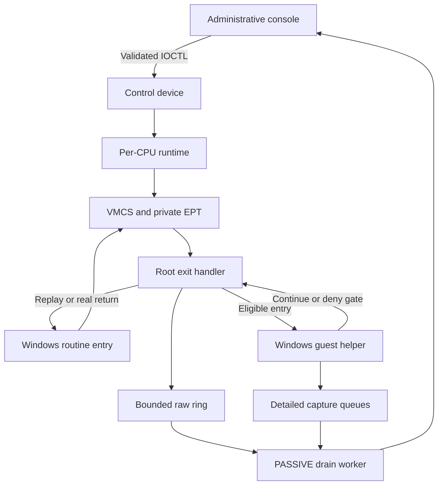
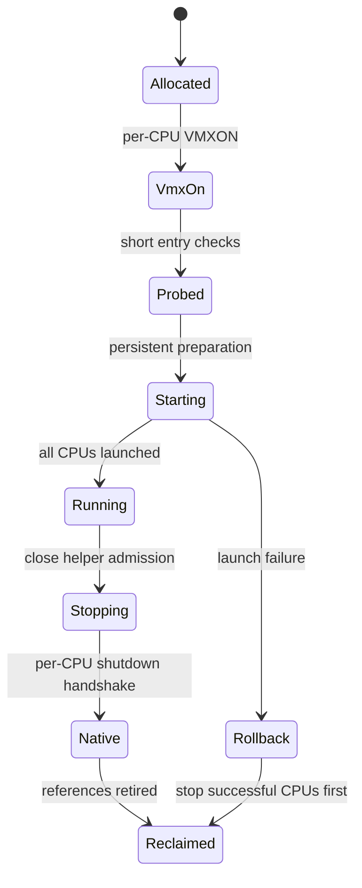
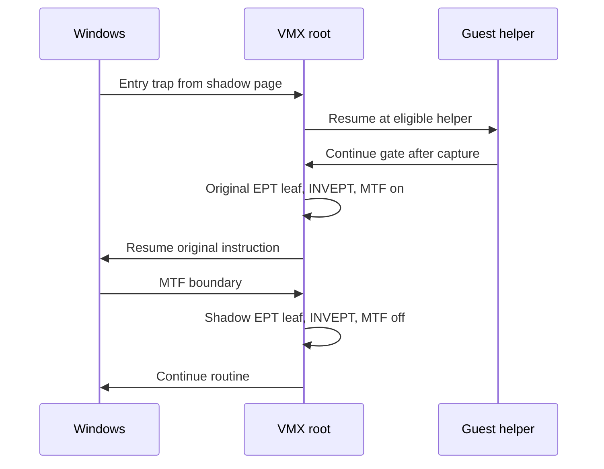

# Velum: preserving Windows execution across VMX transitions

## An implementation study of EPT entry observation, scoped policies and native return

25 October 2026

[Project](../../README.md) | [Usage guides](../README.md) | [Runtime evidence](../../assets/capture-manifest.md)

## Abstract

Velum is a Windows x64 research hypervisor implemented in C and assembly. It brings an already-running kernel into Intel VMX non-root operation, observes selected exported entries through private EPT mappings, and evaluates bounded request policies in eligible Windows execution contexts. An administrative console controls hooks, telemetry, CPUID identity fields and a fixed TSC offset.

The difficult part is preserving execution across context changes. An observed entry can cross an EPT translation, a VM exit, a guest helper, and a replay or return path. Each stage owns different state. Correct continuation requires more than a valid VMCS: the normal stack, CET shadow stack, interruptibility, pending events, translation caches and driver lifetime must remain consistent.

This article follows those transitions through the implementation. It also documents a Windows 10 VMware startup investigation, an export-alias failure, a conditional CR0.TS defect, and interrupted-event handling. Source excerpts, WinDbg sessions and runtime captures connect each design decision to its implementation and test results. The runtime combines per-CPU ownership, selective interception and deferred telemetry to keep the VM-exit path focused on state transitions.

## Contents

1. [Scope and evidence](#1-scope-and-evidence)
2. [Execution domains and ownership](#2-execution-domains-and-ownership)
3. [Launching a running kernel](#3-launching-a-running-kernel)
4. [VMCS controls and exit state](#4-vmcs-controls-and-exit-state)
5. [EPT construction and translation lifetime](#5-ept-construction-and-translation-lifetime)
6. [Entry traps and instruction replay](#6-entry-traps-and-instruction-replay)
7. [Guest capture and policy execution](#7-guest-capture-and-policy-execution)
8. [CET and a real return](#8-cet-and-a-real-return)
9. [Events, NMIs and interrupted IRET](#9-events-nmis-and-interrupted-iret)
10. [Telemetry and administrative control](#10-telemetry-and-administrative-control)
11. [CPUID, TSC and coordinated updates](#11-cpuid-tsc-and-coordinated-updates)
12. [Shutdown and reclamation](#12-shutdown-and-reclamation)
13. [Windows 10 VMware investigation](#13-windows-10-vmware-investigation)
14. [The ExFreePool alias failure](#14-the-exfreepool-alias-failure)
15. [The CR0.TS correction](#15-the-cr0ts-correction)
16. [Runtime evidence and validation](#16-runtime-evidence-and-validation)
17. [Operating model and further work](#17-operating-model-and-further-work)
18. [Source map and references](#18-source-map-and-references)

## 1. Scope and evidence

Velum uses late-launch, in-place virtualization. Windows is already booted when the driver takes control of VMX and continues using its existing address space and devices. A physical-machine configuration and a VMware nested configuration exercise the same driver under different virtualization owners.

The project contains 24 active target definitions: 12 Nt routines and 12 Ex/Mm routines. A target is an exported function entry. Interception uses EPT mappings at selected exported entries, leaving the SSDT and IA32_LSTAR intact. `syscall.c` manages the native-call target group; each hook observes execution through its resolved entry.

Compatibility depends on more than the Windows product name. A target must resolve to an export, have a supported entry instruction, fit the patching constraints, and have a usable address identity. The resolver and entry recognizer validate these requirements before installation.

Three kinds of evidence appear below:

| Evidence | What it establishes |
| --- | --- |
| Source inspection | Implemented paths, checks and state transitions |
| WinDbg sessions and runtime tests | Windows 10/11 startup, compatibility and hook behavior |
| Recorded 24 October physical-machine session | Visible workload outcomes and checks described in its manifest |

The physical-session manifest records a source inventory digest, binary hashes, test workloads and results. These identify the artifacts used for the screenshots and animations.

The intended setting is an authorized, recoverable laboratory. Policy decisions operate on eligible captured inputs at the selected entries; the policy section describes context checks and fallback behavior.

## 2. Execution domains and ownership

The implementation has three execution domains. They share kernel mappings but operate under different constraints.

| Domain | Responsibilities | Constraints |
| --- | --- | --- |
| VMX root on a private stack | Exit dispatch, VMCS updates, EPT leaf changes, bounded register snapshots | No pageable capture, blocking allocation, scheduler calls or formatted logging |
| Windows guest helper | Guarded metadata capture and eligible request-policy evaluation | Original Windows thread and stack; context and pointer checks still apply |
| PASSIVE worker and user-mode console | Queue draining, formatting, module attribution and configuration | Delivery can be delayed, filtered or dropped |



[`PER_CPU_DATA`](../../hypervisor/include/percpu.h) is the ownership boundary for hardware state. It holds VMXON and VMCS allocations, a private 16 KiB host stack, EPT state, guest GPR storage, hook contexts, replay state, native-return state, VPID state and processor configuration. A temporary original-page mapping on one CPU does not publish the same mapping into every other CPU's EPT.

The root address space maps the resident driver code and allocations used by VM-exit handlers. The driver shares the Windows kernel trust domain, while per-CPU EPT state separates each processor's hook and replay mappings.

The central ownership rule is that memory still referenced by hardware or a suspended helper cannot be reclaimed. That rule explains prepared and committed EPT states, owner-core invalidation, helper references and multi-stage shutdown.

### Runtime optimization

The implementation keeps transition work explicit. [`vmx.asm`](../../hypervisor/src/vmx.asm)
contains 994 lines of x64 assembly for entry/exit frames, register preservation,
CET transfer, guest helper gates and native return. C handlers operate on the
saved frame rather than rebuilding architectural state through generic wrappers.

Several choices reduce avoidable work on the VM-exit path:

- Per-CPU VMCS, EPT and replay state keep ownership local to the executing processor.
- Runtime EPT reserves are allocated at PASSIVE_LEVEL before an exit needs them.
- Hardware replays supported entry instructions under temporary mappings.
- MTF runs during replay and return retirement, then is cleared.
- Ordinary I/O, CR3/CR8 and timestamp operations avoid unconditional interception.
- Bounded queues defer formatting and module resolution to PASSIVE-level processing.
- Release builds use `/O2`; VPID is enabled when its required capabilities are available.

These are implementation-level optimizations. Workload-specific timing measurements
can quantify their effect across hook counts, telemetry routes and policy settings.

## 3. Launching a running kernel

[`DriverEntry`](../../hypervisor/src/driver.c) validates processor topology before allocating state. The driver requires one fixed processor group, no more than 64 processors, and an active count equal to the configured maximum. Hot-add is outside this model. Each processor is checked independently so the runtime validates capabilities across the complete active set.

Initialization proceeds through allocation, capability discovery, VMXON, VMCS initialization and EPT construction. Short VM-entry probes and a CPUID handling check precede persistent launch. The optional startup hook self-test is compile-time gated; its execution depends on the selected build configuration.

The probe and persistent phases have different control requirements. A short probe intentionally returns to its launcher. Once Windows is persistently running as a guest, an error cannot be treated as though the old launcher frame were a valid continuation for arbitrary execution.

[`PersistLaunchAllCores`](../../hypervisor/src/persist.c) attaches to the system process before capturing the root address-space context. This avoids retaining a loader-process CR3 whose lifetime is unrelated to the hypervisor. Each launch pins the thread to its CPU, initializes processor and timing state, raises IRQL, clears and loads that CPU's VMCS, and captures live state immediately before entry.

The `Launched` flag is set before VMLAUNCH so even the first VM exit follows runtime rules. If entry fails, the flag is cleared and the error is recorded. If only some CPUs launch, rollback shuts those CPUs down before releasing their state.



Driver unload is not published as an unrestricted operation while the runtime is active. The drain worker enables the unload callback after persistent state becomes stopped. Removing a service name is an administrative operation; leaving VMX safely is an architectural operation.

## 4. VMCS controls and exit state

### Capability adjustment

The code represents control capabilities as required-one and allowed-one masks. `VmcsAdjustControl` in [`vmcs.c`](../../hypervisor/src/vmcs.c) uses:

```c
return (Desired & Allowed.Allowed1) | Allowed.Allowed0;
```

This constructs a capability-compatible bit pattern. Additional checks reject configurations requiring features the runtime does not implement. Accepting a mandatory exit source without a corresponding handler would turn capability adjustment into a latent failure.

The following table describes persistent operation, rather than the startup probe:

| Mechanism | Runtime choice | Consequence |
| --- | --- | --- |
| EPT | Enabled | Private second-level mappings |
| Exception bitmap | #UD only | Two-byte entry traps; unrelated #UD reinjected |
| CPUID | Handled in root | Control protocol and restricted identity rules |
| NMI exiting and virtual NMIs | Required | Explicit pending-event and blocking management |
| MTF | Off at rest; on for bounded replay/return windows | Regain control at the relevant guest instruction boundary |
| CR0 guest/host mask | Zero | No broad CR0 write-interception policy |
| CR4 guest/host mask | VMXE bit | Preserve VMX ownership and the intended guest view |
| CR3/CR8 exits | Not requested; incompatible forced controls rejected | Avoid ordinary address-space and priority-change exits |
| MOV DR, INVLPG, ordinary I/O, RDTSC exits | Not requested in normal runtime | Avoid exits without an implemented need |
| MSR bitmap | Enabled, initially zeroed | Most bitmap-covered accesses do not request exits |
| IA32_TSC_DEADLINE | Read/write intercept with a nonzero offset when supported | Translate timer deadlines between clock domains |
| VPID | Capability-gated | Tagged translations with explicit retirement |
| TSC scaling | Identity multiplier when supported | No runtime frequency-scaling experiment |

A zero MSR bitmap does not mean every MSR is supported or virtualized. The bitmap covers defined low and high ranges. Other accesses and architectural exceptions remain subject to VMX rules. Outer-hypervisor interfaces require their own explicitly implemented handlers.

Controls needed to preserve supported guest instructions, including RDTSCP/RDPID, INVPCID, WAITPKG and XSAVES, are enabled when enumerated and permitted. Unsupported combinations fail setup. The aim is to maintain the guest instruction environment, not maximize interception.

### State outside the VMCS

The VMCS does not save ordinary guest GPRs. [`HvHostEntryStub`](../../hypervisor/src/vmx.asm) saves them explicitly; guest RSP is in its VMCS field. Around C dispatch, the stub uses FXSAVE64 for x87/SSE state and preserves CR2 and DR6, restoring them before continuation.

The root handler uses an x87/SSE preservation contract. Root code must stay within that contract; guest XSAVE capability is separate from the instructions emitted for the handler.

A VMREAD or VMWRITE failure is not a valid zero result. Critical paths test status and prevent ordinary continuation after failure. In persistent operation, `VmExitFail` enters `PersistFatal`; this prevents continuation with invalid architectural state.

## 5. EPT construction and translation lifetime

### Mapping and memory types

[`ept.c`](../../hypervisor/src/ept.c) builds per-CPU identity mappings for Windows physical RAM ranges. Outside hook mappings, guest physical and underlying physical addresses coincide. This is narrower than a general virtual-machine memory manager.

The code captures physical-address width and MTRR state before choosing RAM memory types. Fixed ranges take precedence where enabled, UC dominates applicable overlaps, and the supported WT/WB overlap resolves to WT. Unsupported combinations are rejected. Large 2 MiB leaves are used where range and memory-type conditions permit; smaller leaves represent boundaries and split regions.

EPT memory types are derived from the initialization-time MTRR snapshot. The current mapping model assumes those memory-type settings remain stable while the hypervisor is active.

Runtime page-table memory is reserved at PASSIVE_LEVEL. An absent device/firmware-hole mapping can be installed as an identity UC mapping using this reserve. The exit handler does not allocate pool memory, overwrite existing RAM mappings or relax an existing hook permission to satisfy a fault. Exhausting the reserve or encountering inconsistent tables fails the operation.

### Split, invalidate, retire

A hook needs 4 KiB granularity. Splitting a 2 MiB leaf requires a sequence:

1. Allocate and populate a PML1 table before publication.
2. On the owning CPU, replace the large leaf with the table pointer.
3. Invalidate translations for that EPTP.
4. Retain the table while any leaf differs from the original large mapping.
5. Restore the large leaf only when all 512 constituent leaves match.
6. Finish invalidation before declaring the old table reclaimable.
7. Free retired tables at PASSIVE_LEVEL.

`InvalidationPending` and the split-state fields prevent failed invalidation from being treated as completed retirement. The old table stays live while a cached translation might reference it.

### INVEPT is not INVVPID

`EptInvalidateCurrent` uses single-context INVEPT for the owning EPTP. Mapping and permission changes still require this with VPID enabled. VPID does not make EPT writes self-invalidating.

[`vpid.c`](../../hypervisor/src/vpid.c) selects a nonzero per-CPU identifier and supported INVVPID scope. It invalidates before first use, including reload, and deactivates and invalidates the tag before native return. If optional VPID capability is unavailable, the runtime can fall back when the hardware permits it. It does not silently recycle an active tag.

## 6. Entry traps and instruction replay

### Resolving and preparing an entry

Targets are resolved by name with `MmGetSystemRoutineAddress`. Availability then selects a representative for each resolved address. Microsoft documents that this API resolves kernel or HAL exports and returns NULL when unavailable; it is not a general symbol resolver ([reference](https://learn.microsoft.com/en-us/windows-hardware/drivers/ddi/wdm/nf-wdm-mmgetsystemroutineaddress)).

The virtual-to-physical walker recognizes large leaves and 4 KiB leaves. An entry becomes a physical 4 KiB page plus offset. The installer prepares a shadow copy and an EPT leaf. Targets on the same page share that prepared shadow, with one owner responsible for freeing it.

Different offsets on one page can coexist in a prepared batch. Two names for the same offset are not independent patch sites. That distinction caused the Windows 10 alias failure in Section 14.

### Trap encoding and CET landing pads

If the entry starts with ENDBR64, those four bytes remain intact and the following instruction is examined. `HookReplayInstructionLength` recognizes the entry forms supported by hardware replay. It accepts selected MOV/LEA forms, relative branches/calls and SUB RSP immediate, and rejects unsupported forms or insufficient bytes.

The current implementation has **two trap encodings**. A recognized two-byte instruction is replaced by UD2. Longer supported instructions begin with the three-byte VMCALL encoding. No bytes beyond the first recognized instruction are overwritten. Exact excerpt from [`hook.c`](../../hypervisor/src/hook.c):

```c
        shadow[FunctionOffset] = 0x0F;
        if (patchSize == 2) {
            shadow[FunctionOffset + 1] = 0x0B; // UD2: preserves a two-byte entry instruction.
        } else {
            shadow[FunctionOffset + 1] = 0x01;
            shadow[FunctionOffset + 2] = 0xC1;
        }
```

The #UD bitmap is needed for the two-byte case; it does not mean all entries use UD2. Both trap paths validate the target or internal gate address. An unrelated #UD is reinjected instead of being consumed as a hook event.

### Hardware replay at the original address

An allowed call re-executes the original instruction in hardware at its original virtual address. This path has no relocated prologue trampoline. Root publishes the original EPT leaf, invalidates, leaves RIP at the intercepted instruction and enables MTF:

```c
static ULONG64 VmExitReplayOriginal(PPER_CPU_DATA Cpu, PHOOK_CONTEXT hook)
{
    ULONG64 primary = 0;
    // Publish the original page and invalidate cached execute translations.
    (VOID)InterlockedExchange64((volatile LONG64 *)hook->Pml1Entry,
        (LONG64)hook->OriginalPml1Entry);
    if (EptInvalidateCurrent(Cpu) != 0) { return VmExitFail(Cpu); }

    // Arm MTF so we regain control after one guest instruction.
    if (VmxRead(VMCS_PRIMARY_PROCESSOR_BASED_CONTROLS, &primary) != 0) {
        return VmExitFail(Cpu);
    }
    if (VmxWrite(VMCS_PRIMARY_PROCESSOR_BASED_CONTROLS,
        primary | (ULONG64)PRIMARY_MONITOR_TRAP_FLAG) != 0) {
        return VmExitFail(Cpu);
    }
    Cpu->ReadMtfHook = hook;
    hook->ReadMtfArmed = 1;
    return VMEXIT_ACTION_RESUME;
}
```

Source: `VmExitReplayOriginal`, [`vmexit.c`](../../hypervisor/src/vmexit.c).

At the MTF exit, the handler clears MTF, republishes the execute-only shadow leaf and invalidates again. A data read or write to that execute-only mapping uses the same temporary-original mechanism. The processor executes the access directly under the temporary mapping.



An intervening exit may precede expected replay completion. `VmExitHandleDeferredMtf` restores the shadow before dispatching that event. MTF reports an architectural instruction boundary, so replay retirement also accounts for intervening event delivery. The implementation tracks replay explicitly and prepares interrupted events before paths that can resume early. Intel describes these MTF boundary conditions in its [VMX reference](https://cdrdv2-public.intel.com/671506/326019-sdm-vol-3c.pdf).

The temporary mapping covers a page for the replay window. Hook coverage follows the selected entry, and prepared shadow copies assume the original code remains stable until hooks are rebuilt.

## 7. Guest capture and policy execution

### Why capture runs as a guest

Resolving a file handle, inspecting an object name or reading a user buffer is not safe merely because root has a kernel pointer. These operations can fault, require Windows context or schedule. Velum redirects eligible entries into resident guest assembly, which invokes capture under Windows execution rules.

Before redirection, the dispatcher checks the kernel entry, expected x64 stack alignment, IF, runtime state and helper admission. At a normal x64 entry, RSP is 8 modulo 16. The helper preserves volatile GPRs, flags and XMM0 through XMM5, provides call home space, and passes the original RSP to C. Stack arguments are relative to that original value; argument five is at `OriginalRsp + 0x28`.

The assembly frame has unwind metadata. Its balanced C call/return leaves the target caller's return address in place. The continuation gate returns to root, which restores the original entry RIP and arranges replay. Ineligible contexts use bounded raw observation instead of forcing detailed capture.

`FilterDecide` requires PASSIVE_LEVEL and IF set for the detailed Nt path. User-pointer accesses are guarded, handle lookups use the caller's mode, and capture status accompanies fields. Ex/Mm observation uses a separate `KernelCapture` schema with its own IRQL constraints. It is incorrect to assume every observed entry gets identical metadata.

### Policy is independent of visibility

Three settings are independent: whether an entry is hooked, whether a matching request is changed, and whether its event is displayed. Disabling the console route does not disable policy. Narrowing a log filter does not narrow enforcement scope by itself.

Per-target policy evaluates the captured original inputs. Existing protected-file rules take priority; a later rule cannot undo their denial. Detailed policy evaluation is gated by successful capture, and per-target rules require supported user-mode scope. Incomplete capture generally continues the request. This keeps observation failures on the normal continuation path while reserving policy decisions for validated inputs.

| Action | Implemented scope |
| --- | --- |
| Deny | Eligible matching Nt requests |
| Remove requested access bits | NtCreateFile, NtOpenFile, NtCreateSection, NtOpenProcess and NtDuplicateObject |
| Observe only | Ex/Mm entries |

For the four RDX-based access arguments, the helper computes effective access and updates the saved register. It never adds rights. Generic rights and MAXIMUM_ALLOWED cannot be narrowed reliably by clearing object-specific bits, so a matching reduction rule conservatively denies those forms.

NtDuplicateObject differs because DesiredAccess is argument five. The implementation validates the stack slot and uses compare-exchange against the captured original value. If the slot changed or cannot be updated safely, the request is denied. DUPLICATE_SAME_ACCESS has no explicit mask to reduce; unsupported option combinations are handled conservatively. A denied CLOSE_SOURCE request never reaches the original routine to perform its normal side effect.

### A concrete reduction

The physical-session probe requested `0x0012019F` through NtCreateFile. A scoped rule removed `0x6`, comprising FILE_WRITE_DATA and FILE_APPEND_DATA:

```text
requested = 0x0012019F
remove    = 0x00000006
effective = 0x00120199
```

The open succeeded with reduced rights. A subsequent WriteFile on that handle failed with Win32 error 5, and independently read file contents were unchanged. This connects an input modification with handle behavior for a specific workload, rather than relying only on a log label.


The composite pairs the policy configuration with the application's result, showing the requested-rights transformation and the subsequent denied write. The [manifest](../../assets/capture-manifest.md) records the caller, path and probe sequence.

## 8. CET and a real return

### CET state belongs to the transition

With CET enabled, RIP and RSP do not describe the entire call/return state. The implementation transfers supervisor CET control, the shadow-stack pointer and interrupt shadow-stack-table address when required. It checks the corresponding VM-entry/exit capabilities and rejects unsupported combinations.

The launcher captures this live triplet immediately before entry. No intervening CALL changes the intended shadow-stack position between the sensitive capture and launch. The assembly reads IA32_S_CET and IA32_INTERRUPT_SSP_TABLE_ADDR, obtains SSP with RDSSPQ, writes the guest fields, and configures host fields for the launch mode.

Persistent root execution uses a separate CET-disabled host policy. Guest CET state is preserved through transitions; Windows CET is not globally disabled as a setup shortcut. The startup probe and persistent runtime have different host-state needs. During final native return, guest CET state is transferred into the host state used to leave VMX.

The startup trace showed CET transfer enabled. CET handling preserves state across VM transitions; the Windows 10 startup investigation separately identified the VMware configuration change described in section 13.

### Denial consumes the real return

Reading a return address from the normal stack, advancing RSP and assigning RIP would bypass the hardware return operation and its shadow-stack semantics. Instead, Velum resumes the guest at a real RET with the denied status already in RAX:

```asm
HvFilterReturn PROC
    ret
HvFilterReturn ENDP
```

Source: [`vmx.asm`](../../hypervisor/src/vmx.asm).

`VmExitFilterBlock` retains the helper reference, records the expected post-RET stack value, temporarily masks ordinary interrupt delivery for the one-instruction window and enables MTF. RET consumes the existing return address and updates SSP in hardware. `VmExitFilterRetired` verifies the expected boundary, restores flags and controls, then releases the reference.

An NMI can win arbitration near that boundary. The retirement handler distinguishes pre-RET and post-RET stack positions and queues pending delivery rather than assuming the first exit proves completion. This is a bounded transition, not an extended region of Windows helper execution with interrupts disabled.

## 9. Events, NMIs and interrupted IRET

### Preparing events before dispatch

A VM exit can interrupt event delivery. The exit reason alone does not describe this state. `VmExitPrepareEvents` executes before dispatch paths that can resume the guest, including pending filter-return handling.

When IDT-vectoring information is valid, the helper carries the event into VM-entry interruption information. It transfers an error code when needed, preserves the instruction length required for software events, and clears a bit reserved in the entry representation. All relevant VMCS operations are checked.

When vectoring is invalid and the reason is EPT violation, qualification bit 12 can report the relevant IRET/NMI-unblocking condition. The helper restores guest NMI blocking while preserving unrelated interruptibility bits:

```c
static ULONG VmExitPrepareEvents(ULONG64 Reason)
{
    ULONG64 vectoring = 0, error = 0, length = 0;
    if (VmxRead(VMCS_IDT_VECTORING_INFORMATION, &vectoring) != 0) { return 1; }
    if ((vectoring & (1ull << 31)) != 0) {
        if ((vectoring & (1u << 11)) != 0 &&
            (VmxRead(VMCS_IDT_VECTORING_ERROR_CODE, &error) != 0 ||
             VmxWrite(VMCS_ENTRY_EXCEPTION_ERROR_CODE, error) != 0)) { return 1; }
        if (((vectoring >> 8) & 7) >= 4 &&
            (VmxRead(VMCS_EXIT_INSTRUCTION_LENGTH, &length) != 0 ||
             VmxWrite(VMCS_ENTRY_INSTRUCTION_LENGTH, length) != 0)) { return 1; }
        vectoring &= ~(1ull << 12); // Reserved in VM-entry interruption information.
    } else {
        vectoring = 0;
        if ((Reason & 0xFFFFu) == EXIT_REASON_EPT_VIOLATION) {
            ULONG64 qualification = 0, blocking = 0;
            if (VmxRead(VMCS_EXIT_QUALIFICATION, &qualification) != 0) { return 1; }
            // Runtime requires virtual NMIs. An interrupted IRET can clear
            // NMI blocking before an EPT exit; restore it before retrying IRET.
            // Qualification bit 12 is defined here only without valid vectoring.
            if ((qualification & (1ull << 12)) != 0 &&
                (VmxRead(VMCS_GUEST_INTERRUPTIBILITY_STATE, &blocking) != 0 ||
                 VmxWrite(VMCS_GUEST_INTERRUPTIBILITY_STATE, blocking | 8ull) != 0)) {
                return 1;
            }
        }
    }
    return VmxWrite(VMCS_ENTRY_INTERRUPTION_INFORMATION, vectoring);
}
```

Source: [`vmexit.c`](../../hypervisor/src/vmexit.c).

These branches must remain distinct. Bit 12 is not a general instruction to change blocking on every exit. The implementation interprets it under the specified reason/vectoring conditions, with virtual NMIs required during runtime setup.

### Root NMI delivery

Persistent operation installs a private IDT. The NMI gate records pending delivery; unexpected root faults enter a fatal path. NMI-window exiting is armed when injection must wait, and injection is coordinated with an already prepared entry event. Pending state tracks delivery eligibility rather than a timestamped NMI history.

The event helper has 1,936 host checks using mocked VMCS operations. They exercise the actual helper, including failed reads/writes and unrelated-bit preservation. They do not reproduce hardware arbitration or concurrent NMI arrival. Those remain separate runtime validation tasks.

## 10. Telemetry and administrative control

### Bounded capture and deferred interpretation

Root raw events use per-core rings. The syscall ring contains 256 cache-line-sized entries per CPU. Detailed Nt capture and kernel telemetry use separate bounded queues. A PASSIVE worker wakes on an approximately 10 ms timeout, subject to scheduling, and drains, formats and delivers events.

This keeps formatted logging out of the normal exit path. Routes, filters and queue occupancy determine which captured events reach a view; the diagnostic counters distinguish inactive delivery from queue saturation.

Kernel telemetry has a 512-entry capture queue and a bounded module snapshot. Summaries associate routine, immediate return-site module, tag and input values. They do not reconstruct complete call stacks or correlate every allocation with its eventual free. Input-byte totals are not outstanding allocation sizes.

The physical-session summary recorded **1,303,982 queue drops** and **2,384 summary overflow events** under ambient desktop activity. Saturation counters remain visible alongside aggregated inputs, making event loss explicit when producers outpace the drain worker.

### Interpreting an event

`CONTINUE` identifies an entry-policy decision, not successful completion of the routine. A requested length is an input; a pointer value is not the pointed-to payload. Normal entry telemetry does not capture completion status, output handles or file contents. Policy PoCs therefore need independent application results.

Export aliases impose an additional limit: a shared entry cannot identify the symbolic name a caller used. An untagged ExFreePool call can have an uninterpretable tag register even if the representative is ExFreePoolWithTag.

### Administrative control surface

[`MonitorInitialize`](../../hypervisor/src/monitor.c) creates an exclusive device with this descriptor:

```text
D:P(A;;GA;;;SY)(A;;GA;;;BA)
```

Access is granted to SYSTEM and built-in administrators. Configuration requests validate sizes, versions and target capabilities. Changes are serialized against shutdown. The control interface uses the existing Windows administrative trust boundary.

Console profiles preserve selected preferences, not all driver state. Policy, runtime CPUID/TSC settings and protected paths have distinct lifetimes. Closing a console ends its delivery path; it does not imply hook removal or native return. These distinctions are documented in the [usage guides](../README.md).

## 11. CPUID, TSC and coordinated updates

### CPUID configuration and control

The handler executes the requested leaf/subleaf and applies implemented adjustments. A reserved control leaf is handled separately. Privileged mutation commands validate their internal entry context; the public menu is not an arbitrary VMCS-writing interface.

Editable identity rules are limited to 16 exact leaf/subleaf entries and restricted identity fields. Feature, topology and frequency claims are not arbitrary overrides. Guest leaf-1 VMX and hypervisor-present bits are cleared as baseline behavior, independently of optional identity rules. The control interface and default vendor identity remain part of the documented CPUID behavior.

The recorded demonstration changed the hypervisor vendor to `VelumLabDemo`, applied it, queried the live leaf, then reset and applied defaults. Reset restored the Velum defaults; it did not disable all overrides.

### A fixed offset is not exit compensation

TSC begins with zero offset. Supported scaling uses the identity multiplier `0x0001000000000000`, with 48 fractional bits. The offset accepts bounded signed ticks, not milliseconds, and does not change frequency. For this identity-scaling experiment:

```text
guest timestamp = underlying timestamp + selected offset
underlying deadline = guest deadline - selected offset
```

Changing only timestamps would leave an armed deadline in the wrong domain. [`tsc.c`](../../hypervisor/src/tsc.c) translates deadlines and enables the corresponding MSR read/write intercept while a nonzero offset requires it. It preserves zero-deadline semantics and checks offset-related overflow. The source acknowledges a race during rebasing: a deadline expiring in that window can produce an extra timer interrupt.

No per-exit measurement is subtracted from the guest clock. A screenshot showing ON/100 ticks demonstrates configuration, not reduced VM-exit cost. Offset changes can alter observed clock continuity and remain explicit lab experiments. CPUID frequency leaves are not filled with guessed values when enumeration is incomplete.

### Completed-operation consistency

[`ProcessorSet`](../../hypervisor/src/processor.c) serializes updates, broadcasts them to participating CPUs, and publishes global configuration only after success. On failure it broadcasts the previous state. If rollback fails, it bugchecks rather than deliberately continue with inconsistent per-core clocks.

This defines the result after the coordinated update completes. Processors pass through the update interval individually; the operation reports success after the participating CPUs have applied the configuration.

## 12. Shutdown and reclamation

Shutdown first closes admission to guest helpers and drains existing references. A helper can fault and sleep while resolving metadata. Its continuation must remain valid across scheduling, so checking whether a root handler is currently executing is insufficient.

```c
VOID FilterCloseAndDrain(VOID)
{
    LARGE_INTEGER interval;
    interval.QuadPart = -10000; // 1 ms, shutdown only; never in the filter.
    (VOID)InterlockedOr(&g_FilterReferences, FILTER_CLOSED);
    while ((InterlockedCompareExchange(&g_FilterReferences, 0, 0) & ~FILTER_CLOSED) != 0) {
        // A guest read can fault and schedule. Keep VMX and driver text alive
        // until its final root continuation (or real guest RET) has completed.
        (VOID)KeDelayExecutionThread(KernelMode, FALSE, &interval);
    }
}
```

Source: [`filter.c`](../../hypervisor/src/filter.c).

The wait is in shutdown, not the exit handler. Once outstanding work drains, lifecycle code initiates the per-CPU handshake.

[`PersistPrepareNative`](../../hypervisor/src/native.c) captures live guest control registers, segment and descriptor-table state, debug state and CET state where enabled. It retires VPID while still in private root state, programs host fields for the final call-free CPUID/VMCALL sequence, and redirects host RIP to native-exit assembly.

The final exit loads the intended Windows state. Assembly executes VMXOFF and completes the native continuation. CR4.VMXE is cleared only after VMXOFF, preserving other live guest changes. Per-core active flags are cleared by code that executes after successful native return.

This avoids restoring only driver-load state after the guest has legitimately changed, and avoids freeing memory while hardware or helpers still reference it. The console requests this protocol before stopping and deleting the driver service.

## 13. Windows 10 VMware investigation

### Observed failure boundary

The initial symptom was a Windows 10 VM freeze during driver loading while a Windows 11 VM ran successfully. The startup trace identified Windows 10 build 19045, an Intel i7-12700F and four virtual processors. The recorded VMware version was Workstation 26.0.0, build 25388281.

The last recorded progress narrowed the problem to persistent startup:

```text
START: persistent core 0 returned status=0x00000000
START: persistent core 1 entering launch
VMCS: core 1 runtime pin=0000003E primary=9400617A secondary=0010102A
```

These lines narrowed the investigation to persistent startup after core 0 completed. The next step was to compare the Windows 10 and Windows 11 VM configurations.

The WinDbg session also identified the guest processor count and kernel family:

```text
1: kd> vertarget
Windows 10 Kernel Version 19041 MP (4 procs) Free x64
Product: WinNt, suite: TerminalServer SingleUserTS
Edition build lab: 19041.1.amd64fre.vb_release.191206-1406
Kernel base = 0xfffff805`4da00000 PsLoadedModuleList = 0xfffff805`4e62a770

1: kd> !cpuinfo
CP  F/M/S Manufacturer  MHz PRCB Signature    MSR 8B Signature Features ArchitectureClass
 0  6,151,2 GenuineIntel 2112 0000003600000000                   3d1b3dff 0
 1  6,151,2 GenuineIntel 2112 0000003600000000 >0000003600000000<3d1b3dff 0
 2  6,151,2 GenuineIntel 2112 0000003600000000                   3d1b3dff 0
 3  6,151,2 GenuineIntel 2112 0000003600000000                   3d1b3dff 0
```

WinDbg identifies the 19041 kernel family; the startup trace identifies Windows 10 build 19045. Kernel addresses vary between debug sessions.

### Configuration comparison

The working Windows 11 VM had a setting absent from Windows 10:

```ini
hypervisor.cpuid.v0 = "FALSE"
```

Windows 10 was fully powered off, its `.vmx` backed up, and the setting added. Startup succeeded after this change. Nested VT-x/EPT exposure was also required:

```ini
vhv.enable = "TRUE"
```

Matching the boot-time CPUID presentation resolved startup in this VMware configuration. The setting is part of the tested nested-virtualization setup; it is specific to that environment.

The outer VMM's boot-time CPUID setting and Velum's runtime CPUID menu operate at different stages. The latter cannot repair decisions Windows made before loading Velum. Guest Hyper-V/VBS ownership and the host's ability to expose nested virtualization are separate questions.

### Reproduction conditions

The [setup guide](../getting-started/README.md) covers build, guest settings and temporary F7 loading. In the tested guest, Memory Integrity was off and the boot entry used:

```bat
bcdedit /set hypervisorlaunchtype off
```

A reboot and actual VBS-state check are required; a UI toggle alone is insufficient evidence. These lab settings reduce protections in the guest. The project does not require globally disabling CET, and a guest setting cannot make an outer VMM expose an unsupported capability.

## 14. The ExFreePool alias failure

### An unsupported-entry result with a valid prologue

After startup worked, enabling the full target set failed with Win32 error 50. The relevant driver message was:

```text
HOOK: syscall idx=19 core=0 prepare failed status=0xC00000BB
```

`0xC00000BB` is STATUS_NOT_SUPPORTED. Index 19 identifies ExFreePool in this project's protocol, not a Windows system-call number. The console's generic configuration message did not distinguish an unsupported entry from other preparation failures.

The WinDbg disassembly showed a supported prologue:

```text
0: kd> u nt!ExFreePool
nt!ExFreePool:
fffff800`329b70b0 4883ec28        sub     rsp,28h
fffff800`329b70b4 e8974f88ff      call    nt!ExFreeHeapPool (fffff800`3223c050)
fffff800`329b70b9 4883c428        add     rsp,28h
fffff800`329b70bd c3              ret
fffff800`329b70be cc              int     3
fffff800`329b70bf cc              int     3
fffff800`329b70c0 cc              int     3
fffff800`329b70c1 cc              int     3

0: kd> db nt!ExFreePool L10
fffff800`329b70b0  48 83 ec 28 e8 97 4f 88-ff 48 83 c4 28 c3 cc cc
```

Addresses are from that session, not reusable offsets. Export lookup exposed the relevant relationship:

```text
0: kd> x nt!ExFreePool*
fffff800`32350490 nt!ExFreePoolEx (ExFreePoolEx)
fffff800`329b70b0 nt!ExFreePool (ExFreePool)
fffff800`329b70b0 nt!ExFreePoolWithTag (ExFreePoolWithTag)
fffff800`329eff40 nt!ExFreePoolSanityChecks (ExFreePoolSanityChecks)
```

### Symbol identity versus patch-site identity

Both names resolved to the same entry. The first prepared hook changed that offset in the shared shadow. Preparing the second target inspected modified shadow bytes and rejected them. A supported original instruction could therefore still produce an unsupported preparation result.

The fix operates on addresses, not Windows versions. Availability selects one representative per nonzero resolved address, preferring ExFreePoolWithTag for this alias. Distinct addresses retain both targets. Installation also rejects duplicate addresses before modification.

This exact branch in [target_entries.h](../../shared/target_entries.h) implements the preference:

```c
if (Preferred < Count && Addresses[i] == Addresses[Preferred]) {
    if (i == Preferred) { mask |= UINT32_C(1) << i; }
    continue;
}
```

Address-based deduplication preserves both hooks whenever they resolve to different entries and selects ExFreePoolWithTag when they share one. All-hook operation passed in both Windows 10 and Windows 11 guests after the fix.

A shared entry cannot recover which export name the caller intended. An untagged ExFreePool call does not provide a meaningful tag just because the selected representative is ExFreePoolWithTag. The displayed tag therefore needs to be interpreted according to the calling routine's arguments.

## 15. The CR0.TS correction

A separate review found a conditional startup defect. The host stub executes FXSAVE64. If host CR0 inherits TS set, that instruction can raise #NM before normal dispatch. Common host-state construction now clears TS:

```c
VMCS_WRITE(Cpu, Index, VMCS_HOST_CR0, Live->Cr0 & ~8ull, "HOST_CR0");
```

Source: [vmcs.c](../../hypervisor/src/vmcs.c). The launcher also saves and restores native CR0. Guest CR0 is not globally cleared as a workaround; host execution needs and guest state preservation are separate concerns.

This was a separate state-preservation fix. The Windows 10 freeze persisted with `CR0=0x80050033` and TS clear, then resolved after the VMware configuration change.

## 16. Runtime evidence and validation

### Recorded physical-machine session

The capture manifest records Windows 11 build **26300.9711** on a physical Intel i7-12700F system with **20 logical processors**. This session complements the Windows 10/11 VMware tests.

| Test | Result |
| --- | --- |
| Startup and diagnostics | Persistent launch; 20/20 CPU checks passed |
| NtWriteFile observation | Caller, path and six-byte request captured |
| Scoped denial | Same handle: success, error 5 with unchanged contents, success after disabling |
| Access reduction | Reduced rights; open succeeded; subsequent write denied |
| CPUID apply/reset | Live vendor changed and default restored |
| TSC configuration | ON/100 ticks, then OFF/0 |
| Kernel summary | Inputs grouped by routine/module/tag with saturation counters |
| Shutdown | Native return verified on all CPUs; service removal confirmed |


Hashes, the source inventory digest, workloads and capture processing are preserved in the [manifest](../../assets/capture-manifest.md). GIFs are chronological screenshot sequences with reading pauses, not continuous video. Access and TSC comparisons are labeled composites. 

### Windows 10 and Windows 11

The Release driver and console were tested on **Windows 10 22H2** and
**Windows 11 26H2**. All-hook activation and normal runtime operation passed on
both systems. Published binary hashes are in the [validation record](../../assets/release-validation.md).

### Host regression checks

Development checks cover input handling, policy matching, formatting, profiles,
processor settings and event preparation. These local regression suites are
maintained separately from the public source package.

The suites were rerun on 24 October with this output:

```text
PASS: 8272 host-only input, path, policy, formatter, profile and processor checks.
VM-exit event tests: 1936 checks passed
```

The 10,208 checks cover host logic and mocked VMCS event handling. The event suite exercises the production helper's propagation and failure branches; runtime sessions exercise the hardware paths.

The build uses `/W4 /WX` and validates PE output properties. `build.bat diagnostic` retains matching symbols separately. A PDB rebuilt later need not match an older loaded driver. Retain the driver, console and symbols from the same build for an investigation.

### Reproduction protocol

For a future revision, record a commit identifier and binary hashes, then use the documented setup in a disposable environment. Begin with one named hook and no policies. Establish an independent baseline, apply one narrowly scoped rule, repeat the operation, and verify the event and external result. Disable the rule and repeat again. Preserve drops, unavailable targets and failures in the record.

Collect a complete startup log before loading. Useful debugger inputs include `.logopen`, `vertarget`, `!cpuinfo`, relevant `u` and `db` output, and the exact driver error. For multiprocessor context collection, `!running -it` is useful; one stack need not identify the CPU that stopped making progress.

## 17. Operating model and further work

The implementation uses a fixed processor group of up to 64 CPUs and an
initialization-time MTRR snapshot. Hook coverage follows resolved entries and
supported prologues. Policies use eligible captured inputs; telemetry retains
bounded queues with explicit drop counters. The driver shares the Windows kernel
trust domain. Nested guest VMX, general forwarding to an outer VMM, live patch
synchronization, and sleep/resume or CPU hot-add are outside the current operating
model.

Further work can build on the tested startup, hook, policy and shutdown paths:

| Area | Next investigation |
| --- | --- |
| Runtime cost | Compare unloaded, loaded, hooked, logging and policy workloads |
| Concurrency | Exercise hook updates and shutdown under sustained traffic |
| Event delivery | Target interrupt/NMI timing around replay and return retirement |
| Telemetry throughput | Measure producer rates, queue occupancy and drain throughput |
| Path matching | Extend alias, reparse-point and shared-handle workloads |
| Platform coverage | Expand the Windows build and nested-VMM configuration matrix |
| Lifecycle | Investigate coordinated power and topology transitions |

The [capture manifest](../../assets/capture-manifest.md) describes the file-probe
API calls, access masks and payload used for the policy demonstrations, providing
a concrete workload for further testing.

## 18. Source map and references

| Implementation | Reading purpose |
| --- | --- |
| [driver.c](../../hypervisor/src/driver.c) | Initialization, probes, worker and rollback |
| [percpu.h](../../hypervisor/include/percpu.h) | State ownership and C/assembly contract |
| [vmcs.c](../../hypervisor/src/vmcs.c) | Capabilities and guest/host state |
| [vmx.asm](../../hypervisor/src/vmx.asm) | Frames, CET capture, helpers and native return |
| [ept.c](../../hypervisor/src/ept.c) | Memory types, splits, runtime holes and retirement |
| [hook.c](../../hypervisor/src/hook.c) | Shadow ownership, entry forms and commit |
| [vmexit.c](../../hypervisor/src/vmexit.c) | Replay, events, return retirement and dispatch |
| [filter.c](../../hypervisor/src/filter.c) | Capture, policy and helper lifetime |
| [syscall.c](../../hypervisor/src/syscall.c) | Target resolution, raw rings and hook coordination |
| [target_entries.h](../../shared/target_entries.h) | Address-based deduplication |
| [monitor.c](../../hypervisor/src/monitor.c) | Administrative IOCTLs and routes |
| [kernel_telemetry.c](../../hypervisor/src/kernel_telemetry.c) | Kernel input capture and summaries |
| [processor.c](../../hypervisor/src/processor.c) | All-core configuration and rollback |
| [tsc.c](../../hypervisor/src/tsc.c) | Offset and deadline domains |
| [vpid.c](../../hypervisor/src/vpid.c) | Tag checks and invalidation |
| [persist.c](../../hypervisor/src/persist.c), [native.c](../../hypervisor/src/native.c) | Launch, draining and final transfer |

Architectural terminology follows the [Intel Software Developer's Manuals](https://www.intel.com/content/www/us/en/developer/articles/technical/intel-sdm.html). Consult VMX controls, VM-entry/exit, EPT, VPID and CET in the edition being used; section numbers vary. The source map identifies what Velum actually implements.

Windows contracts and deployment requirements are documented by Microsoft: [kernel export lookup](https://learn.microsoft.com/en-us/windows-hardware/drivers/ddi/wdm/nf-wdm-mmgetsystemroutineaddress), [Windows Startup Settings](https://support.microsoft.com/en-us/windows/experience/startup-boot/windows-startup-settings), and [Hyper-V coexistence](https://learn.microsoft.com/en-us/troubleshoot/windows-client/application-management/virtualization-apps-not-work-with-hyper-v). The VMware setting above records the configuration used in the successful Windows 10 startup test.
